

  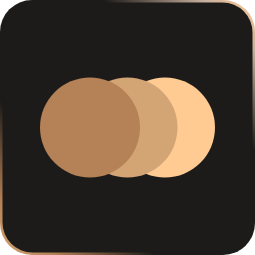

<h1 align="center">Retroscope</h1>

  Warm, retro themes for VS Code, Cursor and Antigravity. Easy on the eyes for long sessions.

  
  
  
  

- **Focused on your code.** A warm dark palette that keeps the visual weight on your code.
- **Accessible.** Designed around the WCAG 2.2 contrast guidelines.
- **Colour-blind friendly.** Syntax colours stay distinct with protanopia, deuteranopia and tritanopia, as well as with typical colour vision.
- **Consistent across editors.** The same look and feel in VS Code, Cursor and Antigravity.
- **Broad language support.** Thorough syntax colouring across a wide range of languages.

## Themes

### Retroscope

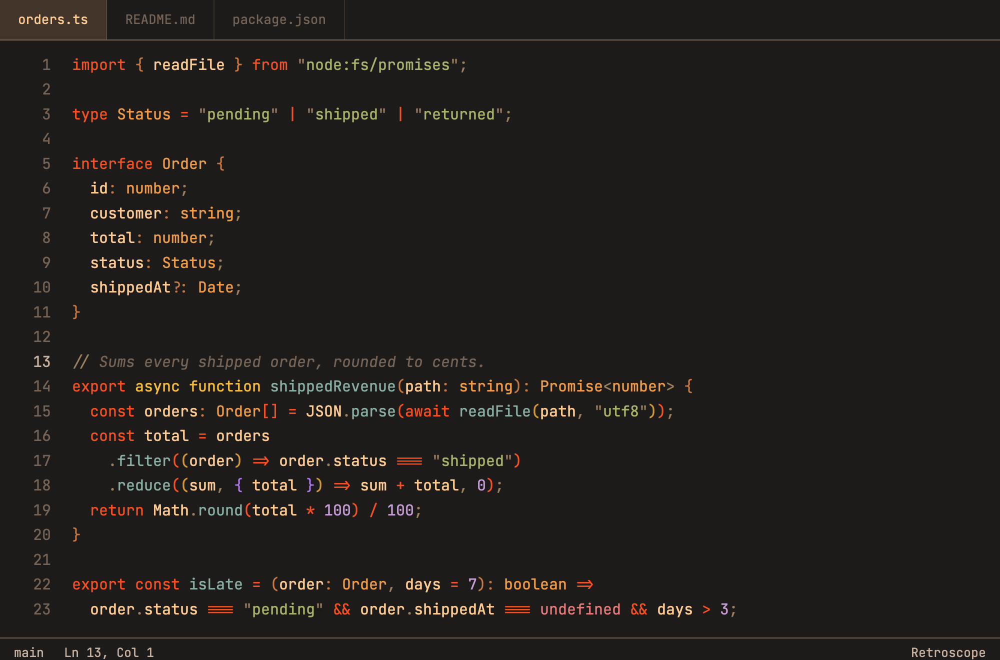

### Retroscope High Contrast

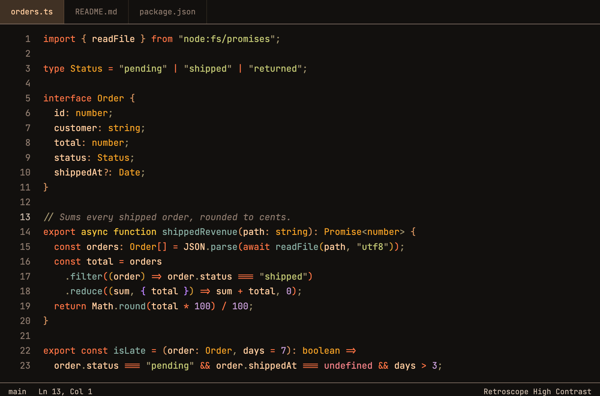

### Retroscope Soft

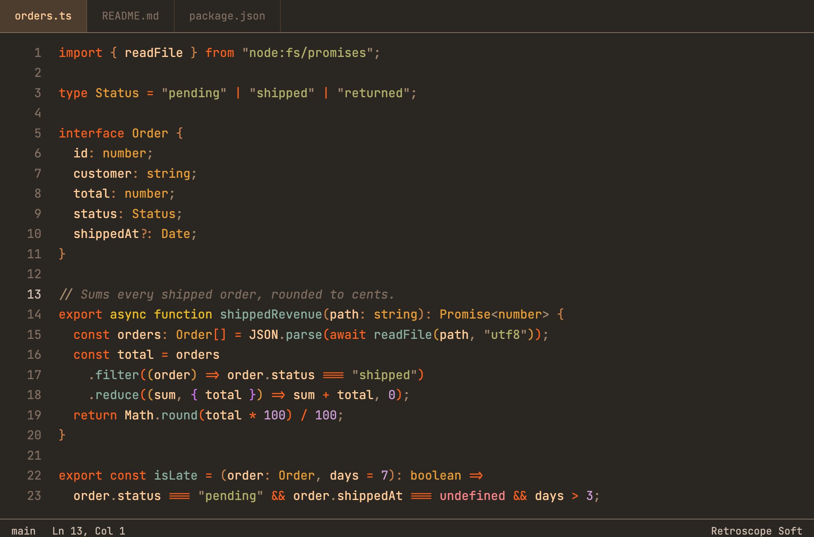

### Retroscope Amber

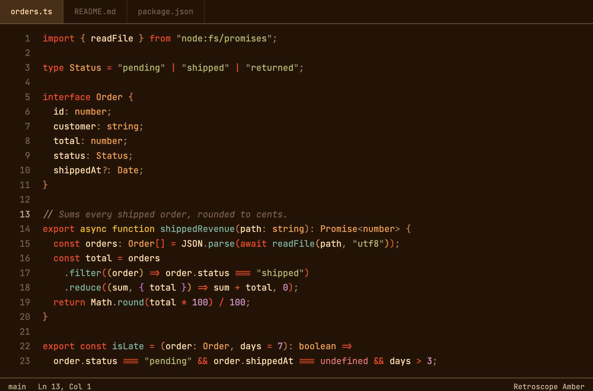

### Retroscope Cassette

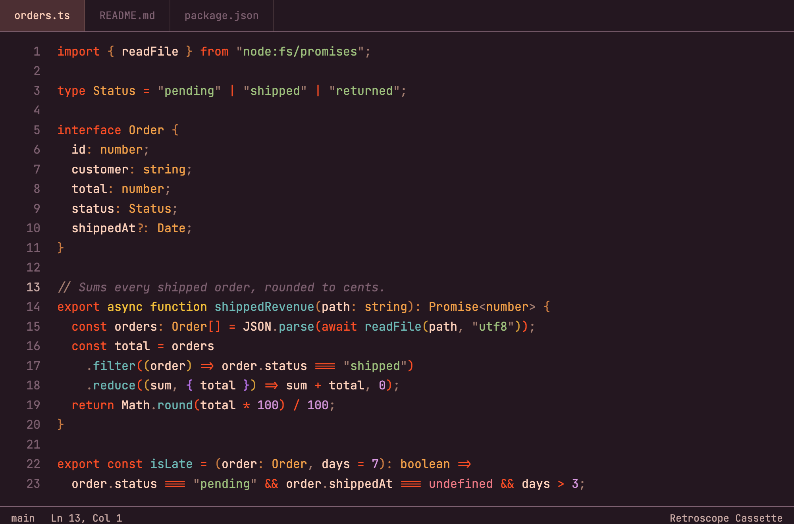

### Retroscope Phosphor

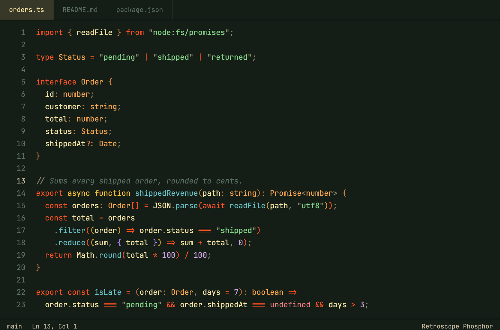

### Retroscope Paper

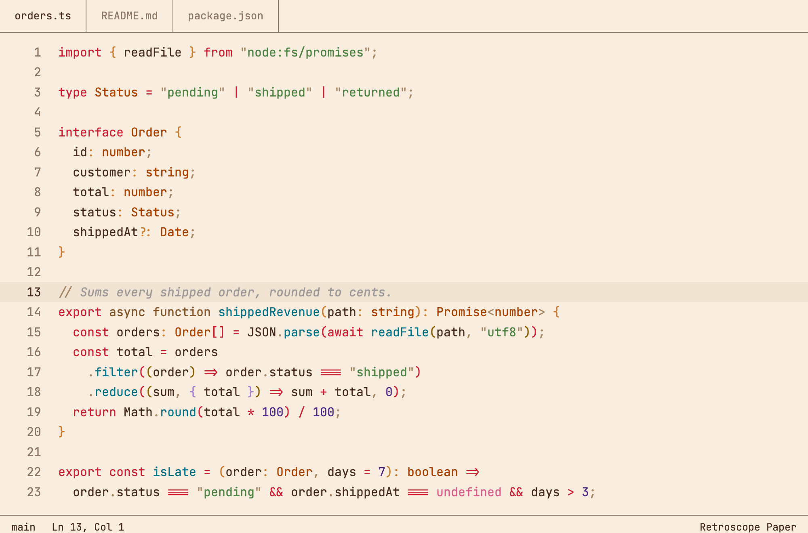

### Retroscope Dawn

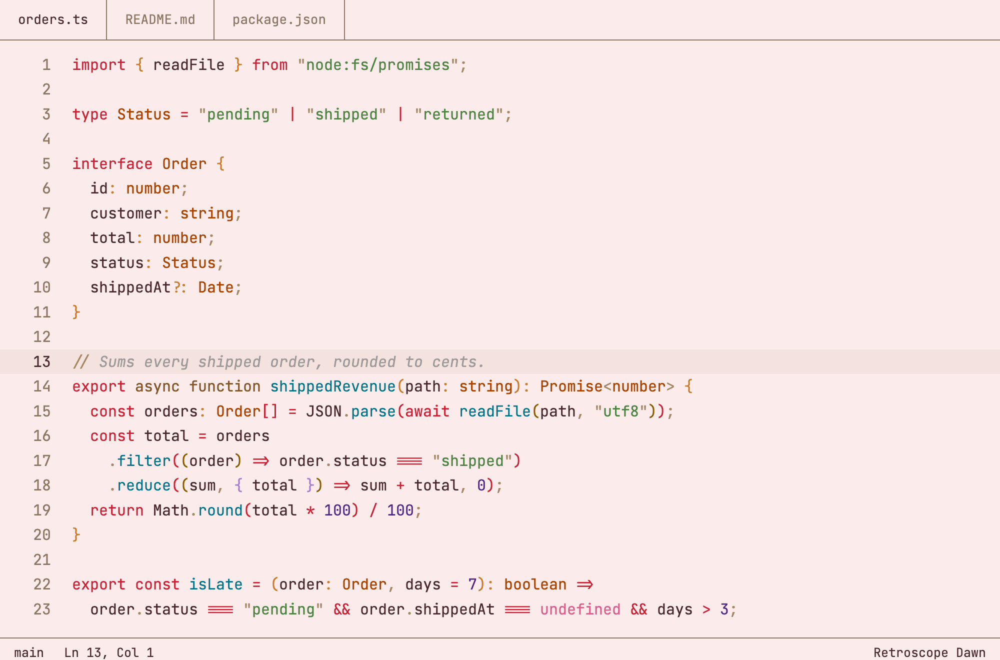

### Retroscope Ledger

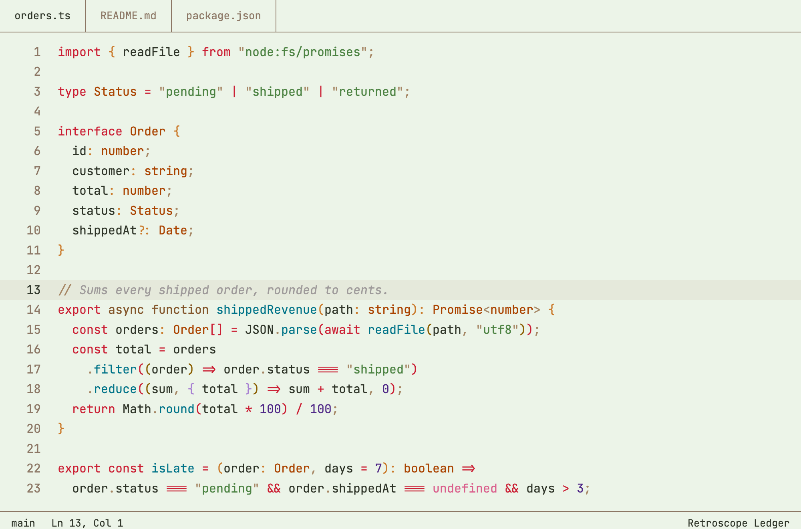

## Languages

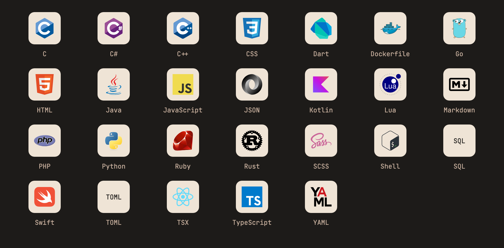

- C
- C#
- C++
- CSS
- Dart
- Dockerfile
- Go
- HTML
- Java
- JavaScript
- JSON
- Kotlin
- Lua
- Markdown
- PHP
- Python
- Ruby
- Rust
- SCSS
- Shell
- SQL
- Swift
- TOML
- TSX
- TypeScript
- YAML

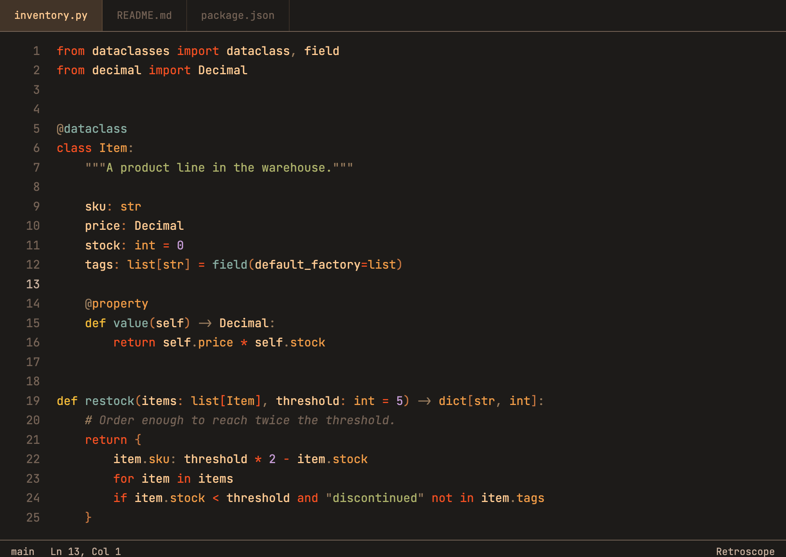

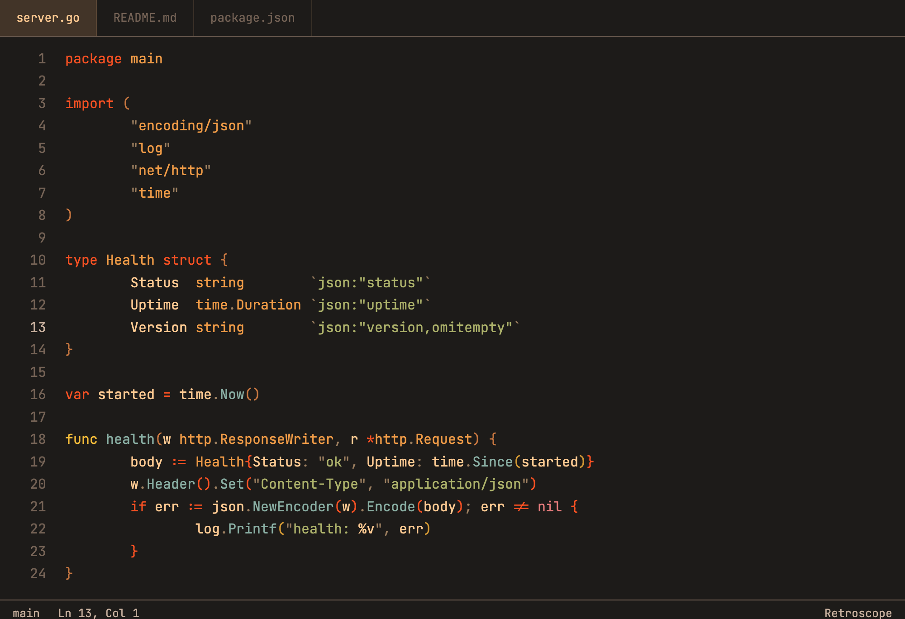

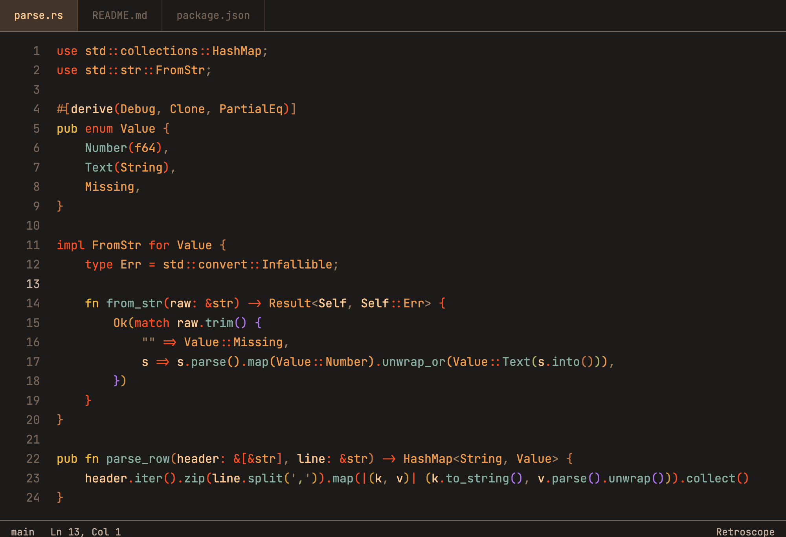

## Install

- **VS Code:** open the Extensions view, search for **Retroscope** and choose **Install**, or run `code --install-extension dvsu.retroscope`. Also on the [Visual Studio Marketplace](https://marketplace.visualstudio.com/items?itemName=dvsu.retroscope).
- **Cursor, Antigravity and other editors that use Open VSX:** search for **Retroscope** in the Extensions view. Also on [Open VSX](https://open-vsx.org/extension/dvsu/retroscope).

Then open the Command Palette, run **Preferences: Color Theme** and pick **Retroscope**, **Retroscope High Contrast**, **Retroscope Soft**, **Retroscope Amber**, **Retroscope Cassette**, **Retroscope Phosphor**, **Retroscope Paper**, **Retroscope Dawn** or **Retroscope Ledger**.

## Feedback

Found something hard to read, or a language that looks off? [Open an issue](https://github.com/dvsu/retroscope/issues) with a screenshot and the editor you use. See the [changelog](./CHANGELOG.md) for what's new.

## Licence

[MIT](./LICENSE)
