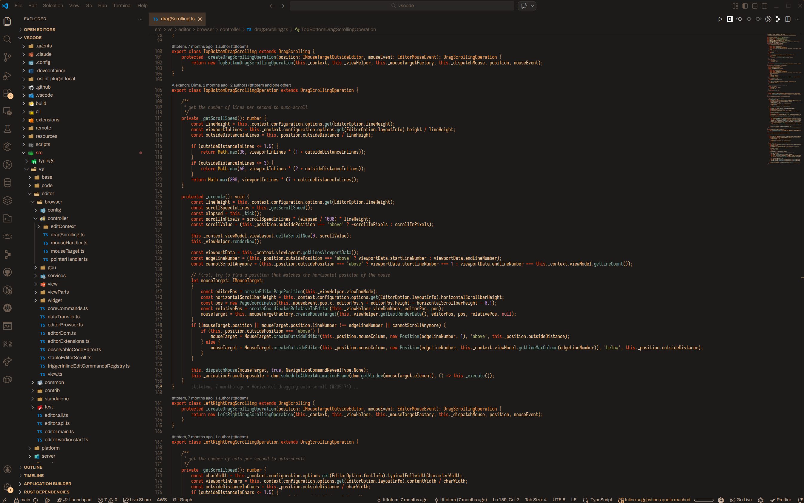

  

<h1 align="center">
  retroscope
</h1>

  Retro theme for VS Code

  

## Themes

- **Retroscope**: the original warm, retro dark theme.
- **Retroscope High Contrast**: code text at 7:1 contrast or more (WCAG AAA), for bright rooms, glare or low vision.
- **Retroscope Soft**: a lighter, gentler dark theme for dim rooms and long evenings.

Pick one with **Preferences: Color Theme** in the Command Palette.

Every theme is tested for WCAG 2.2 contrast, readable hover and selection states, and code colours that stay distinct with protanopia, deuteranopia and tritanopia.
